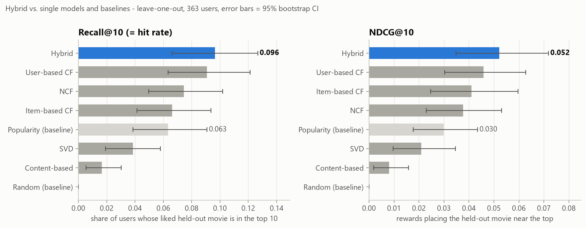
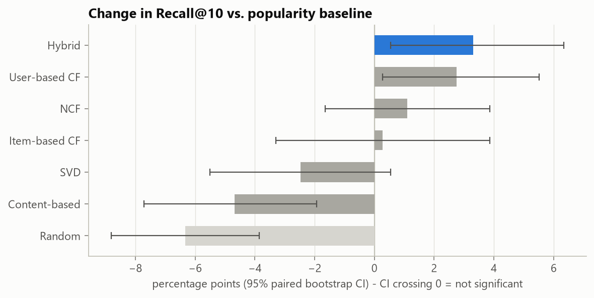
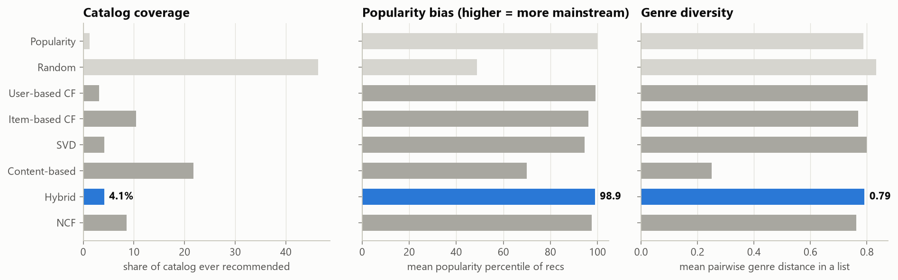
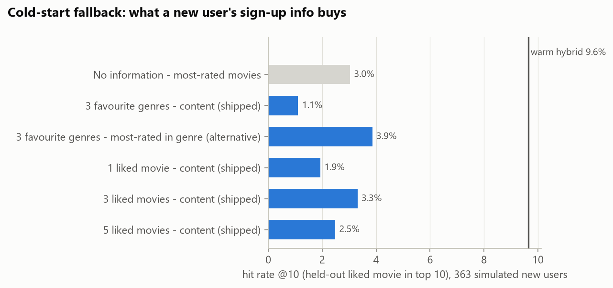
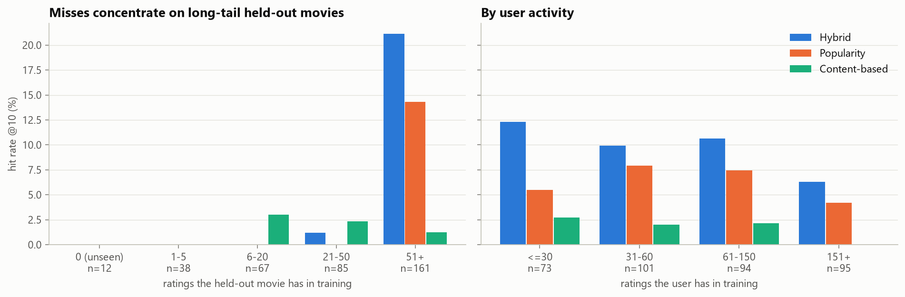

# Evaluation Report: Results, Baseline Comparison, Cold-Start Test and Error Analysis

All numbers in this report are produced by `python src/evaluation/analysis.py`. The script
reads only the committed `outputs/{model}_top10.csv` files, the data splits and the
content-based helpers used by the cold-start fallback. Tables are in `outputs/analysis/` and
figures in `outputs/figures/`.

## 1. Protocol in one paragraph

Each user's most recent rating is held out (leave-one-out). A held-out movie counts as
**relevant** only if it was rated 4.0 or higher, so **363 of the 610 users are evaluated**.
The other 247 held out a movie they did not like. Because every user has exactly one
relevant item:

- **Recall@10 is the hit rate**, the share of users whose liked movie appears in the top 10.
- **Precision@10 can be at most 0.10**. It always equals Recall@10 ÷ 10, so it adds no
  information and is reported only for completeness.
- **NDCG@10 and MRR@10** reward a hit that is ranked near the top of the list.

Uncertainty comes from 5,000 bootstrap resamples of users. Model-vs-model comparisons are
*paired*: they use the same users, with a paired bootstrap CI and an exact McNemar test on
the users where only one of the two models hits.

## 2. Results table

| Model | P@10 | R@10 (95% CI) | NDCG@10 | MRR@10 | RMSE | vs. popularity (McNemar p) |
|---|---|---|---|---|---|---|
| Popularity (baseline) | 0.0063 | 0.0634 (0.039-0.091) | 0.0299 | 0.0198 | - | - |
| Random (baseline) | 0.0000 | 0.0000 (0.000-0.000) | 0.0000 | 0.0000 | - | -6.3 pp (p<0.01) |
| User-based CF | 0.0091 | 0.0909 (0.063-0.121) | 0.0459 | 0.0321 | - | +2.8 pp (p=0.06) |
| Item-based CF | 0.0066 | 0.0661 (0.041-0.094) | 0.0411 | 0.0334 | 0.8922 | +0.3 pp (p=1.00) |
| SVD | 0.0039 | 0.0386 (0.019-0.058) | 0.0209 | 0.0159 | 0.8831 | -2.5 pp (p=0.15) |
| Content-based | 0.0017 | 0.0165 (0.006-0.030) | 0.0081 | 0.0056 | - | -4.7 pp (p<0.01) |
| **Hybrid** | **0.0096** | **0.0964 (0.066-0.127)** | **0.0521** | **0.0387** | - | **+3.3 pp (p=0.04)** |
| NCF | 0.0074 | 0.0744 (0.050-0.102) | 0.0377 | 0.0270 | - | +1.1 pp (p=0.56) |

RMSE uses the 80/20 random split. Only item-CF and SVD predict ratings, so only they have
an RMSE.

## 3. Baseline comparison

**The hybrid is the best model on every ranking metric, and it is the only model that beats
the popularity baseline at the 5% level.** It finds the liked movie for 35 users, against 23
for popularity: +3.3 percentage points, a 52% relative lift (95% CI +0.6 to +6.3 pp,
McNemar p = 0.04). The hybrid hits 21 users that popularity misses, and popularity hits 9
that the hybrid misses.

Three caveats matter for how strongly the result is stated:

1. **The hybrid is effectively a re-ranked user-based CF.** The validation grid search gave
   it the weights `user_cf = 0.6, item_cf = 0.4, svd = 0, content = 0`
   (`outputs/hybrid_weights.json`), and on average 67% of its top-10 overlaps with
   user-CF's (`outputs/figures/model_overlap.png`). Hybrid and user-CF disagree on only 10
   users (6 to 4), so **the two cannot be told apart statistically** (p = 0.75). User-CF
   alone narrowly misses significance against popularity (p = 0.06).
2. **Against other models the hybrid wins clearly** over SVD (+5.8 pp, p < 0.001),
   content-based (+8.0 pp, p < 0.001) and random. Its margins over item-CF (+3.0 pp,
   p = 0.06) and NCF (+2.2 pp, p = 0.28) are not significant.
3. **The lowest RMSE does not mean the best ranking.** SVD has the best RMSE (0.883) but
   ranks worse than popularity. It is optimised to predict rating values well across all
   movies, not to put the one movie a user will watch next into the top 10. This is why
   the blend gives SVD zero weight.

### Beyond accuracy

| Model | Catalog coverage | Mean popularity percentile of recs | Genre diversity | Personalisation |
|---|---|---|---|---|
| Popularity | 1.3% | 99.9 | 0.79 | 0.57 |
| User-based CF | 3.1% | 99.2 | 0.80 | 0.83 |
| Item-based CF | 10.5% | 96.1 | 0.77 | 0.96 |
| SVD | 4.1% | 94.5 | 0.80 | 0.88 |
| Content-based | 21.8% | 69.9 | 0.25 | 0.99 |
| **Hybrid** | **4.1%** | **98.9** | **0.79** | **0.85** |
| NCF | 8.5% | 97.6 | 0.76 | 0.92 |

*Coverage* is the share of the 9,701 training movies recommended to at least one user.
*Genre diversity* is the mean pairwise genre Jaccard distance within a list. *Personalisation*
is 1 minus the mean overlap between two random users' lists.

The README promises that popularity bias is measured, not assumed. Measured, it is
strong: the hybrid recommends only 401 distinct movies to 610 users, and the average
recommended movie sits at the 98.9th popularity percentile. Content-based is the only
model that reaches the long tail, but its lists are narrow in genre (0.25 diversity, because
they cluster tightly around the user's profile) and it is the least accurate.
Item-CF and NCF sit in between, with 2-3 times the hybrid's coverage at lower accuracy.

## 4. Cold-start test

**Setup.** Every MovieLens user has at least 20 ratings, so true cold start has to be
simulated. For each of the 363 evaluated users we **hide their entire history** and give the
fallback only what a sign-up form could ask for. We then check whether their held-out liked
movie appears in the top 10:

| What the new user tells us | Method | Hits | Hit rate @10 |
|---|---|---|---|
| Nothing | Most-rated movies | 11 | 3.0% |
| 3 favourite genres | `content.recommend_from_genres` *(shipped)* | 4 | 1.1% |
| 3 favourite genres | Most-rated movies in those genres *(alternative, not shipped)* | 14 | 3.9% |
| 1 liked movie | `content.recommend_from_movies` *(shipped)* | 7 | 1.9% |
| 3 liked movies | `content.recommend_from_movies` *(shipped)* | 12 | 3.3% |
| 5 liked movies | `content.recommend_from_movies` *(shipped)* | 9 | 2.5% |
| *Full history (reference)* | *Warm hybrid* | *35* | *9.6%* |

The "favourite genres" are the 3 most frequent genres among the user's 4+-rated training
movies. The "liked movies" are their most recent 4+-rated training movies. Popularity
counts come from the training split only.

**Findings**

- **The shipped genre fallback does worse than knowing nothing.** Ranking by TF-IDF
  similarity to a genre query surfaces obscure movies that match the genre string exactly
  and ignores whether anyone watches them. It gets 1.1%, against 3.0% for plain popularity.
- **Combining the stated genres with popularity works best** (3.9%). It is a one-line
  change: filter to the stated genres, then rank by number of ratings.
- **Liked movies help a little.** Three liked movies (3.3%) roughly match popularity, and
  1 or 5 liked movies do worse. Hit counts here are 4-14 users, so the differences
  *between* cold-start strategies are indicative, not significant.
- **Every cold-start strategy reaches only about a third of the warm hybrid's 9.6%.**
  Collecting real ratings is worth far more than any sign-up profile.
- Cold-start popularity (3.0%) scores below the warm popularity baseline (6.3%) because a
  new user's history is unknown. Blockbusters they have already seen cannot be filtered
  out, and those slots are wasted.

**Recommendation:** make `recommend_new_user` blend content similarity with popularity
(genre-filtered popularity in the simplest case), and hand over to the hybrid as soon as
the user has rated a handful of movies.

## 5. Error analysis

### 5.1 Most users are missed by every model

**285 of the 363 users (79%) are missed by all eight models.** Only 78 users are hit by
at least one model. The hybrid hits 35 of them.

### 5.2 Misses concentrate on long-tail held-out movies

| Training ratings of the held-out movie | Users | Popularity | User-CF | Item-CF | SVD | Content | **Hybrid** | NCF |
|---|---|---|---|---|---|---|---|---|
| 0 (unseen) | 12 | 0% | 0% | 0% | 0% | 0% | **0%** | 0% |
| 1-5 | 38 | 0% | 0% | 0% | 0% | 0% | **0%** | 0% |
| 6-20 | 67 | 0% | 0% | 0% | 0% | 3.0% | **0%** | 0% |
| 21-50 | 85 | 0% | 1.2% | 2.4% | 2.4% | 2.4% | **1.2%** | 2.4% |
| 51+ | 161 | 14.3% | 19.9% | 13.7% | 7.5% | 1.2% | **21.1%** | 15.5% |

- **This is the main cause of misses.** 34 of the hybrid's 35 hits are movies with more
  than 50 training ratings. The median held-out movie the hybrid *hits* has 170 training
  ratings, and the median one it *misses* has 37.5.
- **12 held-out movies have no training ratings at all.** The collaborative models and the
  hybrid only score movies seen in training, so these are unreachable by design.
- **No model hits any of the 50 held-out movies with 5 or fewer ratings.** Content-based is
  the only model that hits anything in the 6-20 band (2 of 67). That long-tail signal is
  exactly what the blend throws away when it sets the content weight to 0.

### 5.3 Heavy users are the hardest

| Training ratings of the user | Users | Popularity | Hybrid |
|---|---|---|---|
| 30 or fewer | 73 | 5.5% | **12.3%** |
| 31-60 | 101 | 7.9% | **9.9%** |
| 61-150 | 94 | 7.4% | **10.6%** |
| 151+ | 95 | 4.2% | **6.3%** |

The hybrid does *best* for light users and *worst* for the heaviest. Heavy users have
already rated the blockbusters the hybrid leans towards, so what they watch next is more
niche: their held-out movie has a median of 26 training ratings, against 51-58 for
the lighter groups. Light users' next movie is more often a well-known title. The near-cold users
(30 or fewer ratings) are therefore **not** the weak spot. The weak spot is users whose
taste has moved into the long tail.

### 5.4 Genre of the held-out movie

The hybrid does best on Crime (21%, n = 66), Sci-Fi (19%, n = 53), War (15%, n = 26) and
Thriller (13%, n = 100). These genres are dominated by heavily rated canon films. It does
worst on Comedy (4%, n = 119), Romance (6%, n = 65) and Horror (6%, n = 32), and it
gets 0 hits on Musical, Documentary, Film-Noir and Western (each n ≤ 10). Full table:
`outputs/analysis/errors_by_genre.csv`.

### 5.5 The components are complementary, but the blend does not exploit it

The four blend components between them hit 60 users, against the hybrid's 35. Of the
users the hybrid misses, 41 are hit by at least one single model (including NCF). This
*oracle* union is not an achievable target, because one 10-item list cannot contain every
model's top 10. It does show that each model is right about different users. A single
global weight vector cannot route each user to the model that suits them.

### 5.6 Examples

| | Recently liked (training) | Held-out movie | Hybrid's top 3 |
|---|---|---|---|
| Hit | *The Great Escape; Murder by Numbers; Never Cry Wolf* | *The Shawshank Redemption* (315 ratings) | **Shawshank Redemption**; The Godfather; Raiders of the Lost Ark |
| Hit | *Aliens; The Revenant; Inception* | *Interstellar* (71) | Raiders of the Lost Ark; The Godfather; Empire Strikes Back (hit at a lower rank) |
| Miss: unseen item | *Hawks and Sparrows; My Left Eye Sees Ghosts; Mickey's Once Upon a Christmas* | *Frankenstein 90* (0) | The Godfather; One Flew Over the Cuckoo's Nest; Gladiator |
| Miss: long tail | *Coming to America; Midnight in Paris; Frida* | *Man Up* (1) | Schindler's List; The Godfather; Braveheart |
| Miss: popular item | *Divided We Fall; Under the Sand; Harry Potter 1* | *Bridget Jones's Diary* (64) | The Godfather; Dr. Strangelove; Schindler's List |

The misses show the pattern: a user with arthouse or romantic-comedy taste still gets the
same canon titles, *The Godfather* and *Schindler's List*, because those movies score
highly with almost every neighbourhood. More examples: `outputs/analysis/error_examples.csv`.

## 6. Limitations of this evaluation

- **Small, noisy test set.** One held-out item per user and 363 users give 95% CIs about
  ±3 pp wide. Differences under about 3 pp between models should not be reported as
  real.
- **Only liked held-out items count.** 247 users are excluded. Users whose latest movie
  disappointed them say nothing about ranking quality under this protocol.
- **Recommending an item the user did not watch next is not proof of a bad
  recommendation.** Offline leave-one-out underestimates every model, and it penalises
  long-tail and novel recommendations most.
- **The cold-start test is a simulation.** Stated genres and liked movies are inferred from
  the user's real history. A real sign-up form would collect noisier information.
- The `recommend_new_user` demo in `hybrid.py` computes popularity from the full
  `ratings.csv`. That is fine for the app, but the cold-start evaluation above uses
  training-split counts only, to avoid test leakage.

## 7. Suggested next steps

1. **Fix the cold-start fallback** so it ranks by genre-filtered popularity or a
   content-popularity blend (Section 4).
2. **Add a long-tail or coverage term to the hybrid**, for example a small content weight
   or a popularity penalty. Tune it on validation against a coverage constraint, not on
   recall alone.
3. **Try per-user-segment blend weights** (for example by user activity) or add NCF to the
   blend, to use the complementarity in Section 5.5.
4. **Report sampled-negative metrics (HR@10 over 100 candidates) or use several held-out
   items per user** to narrow the confidence intervals.
